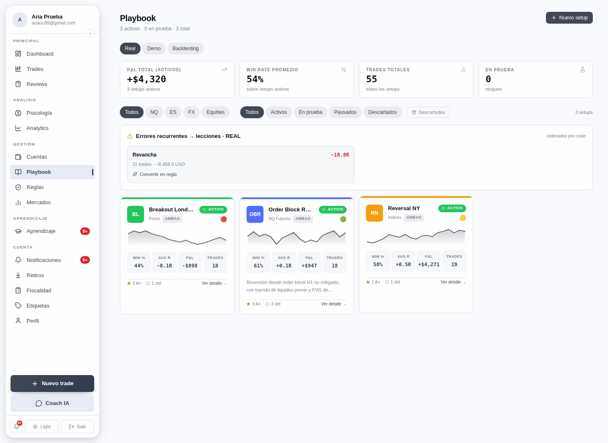
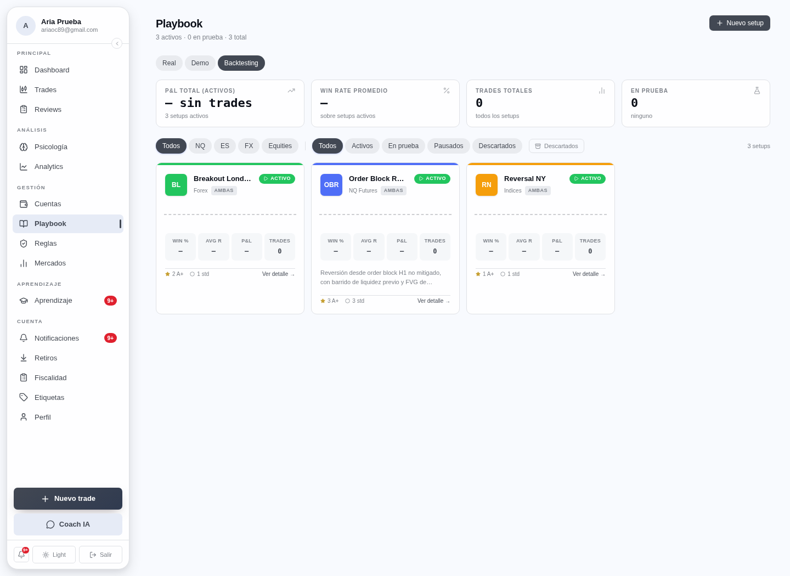
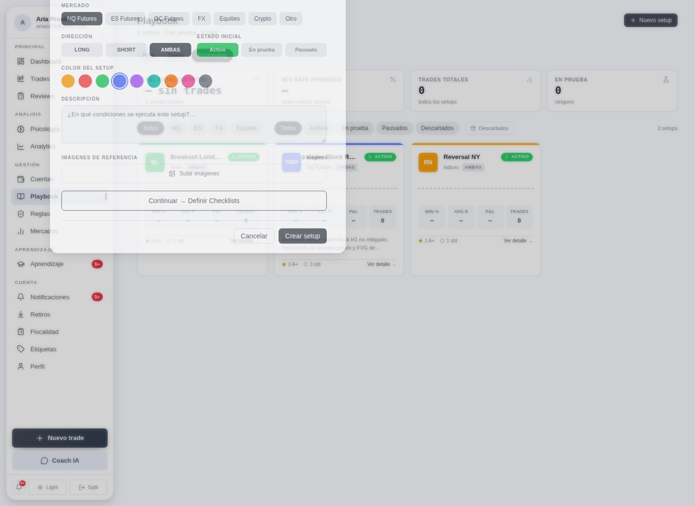
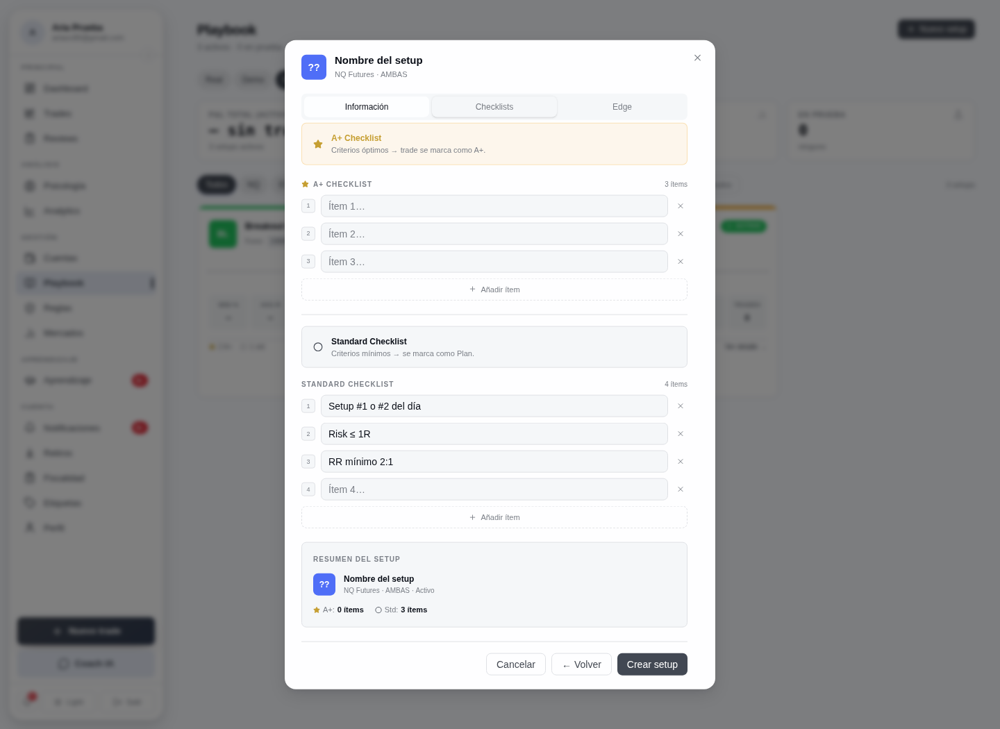
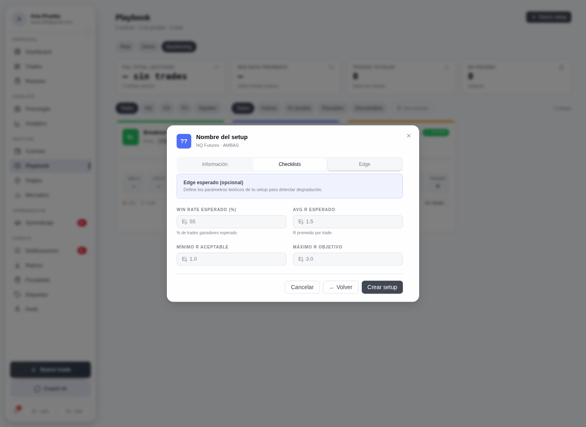
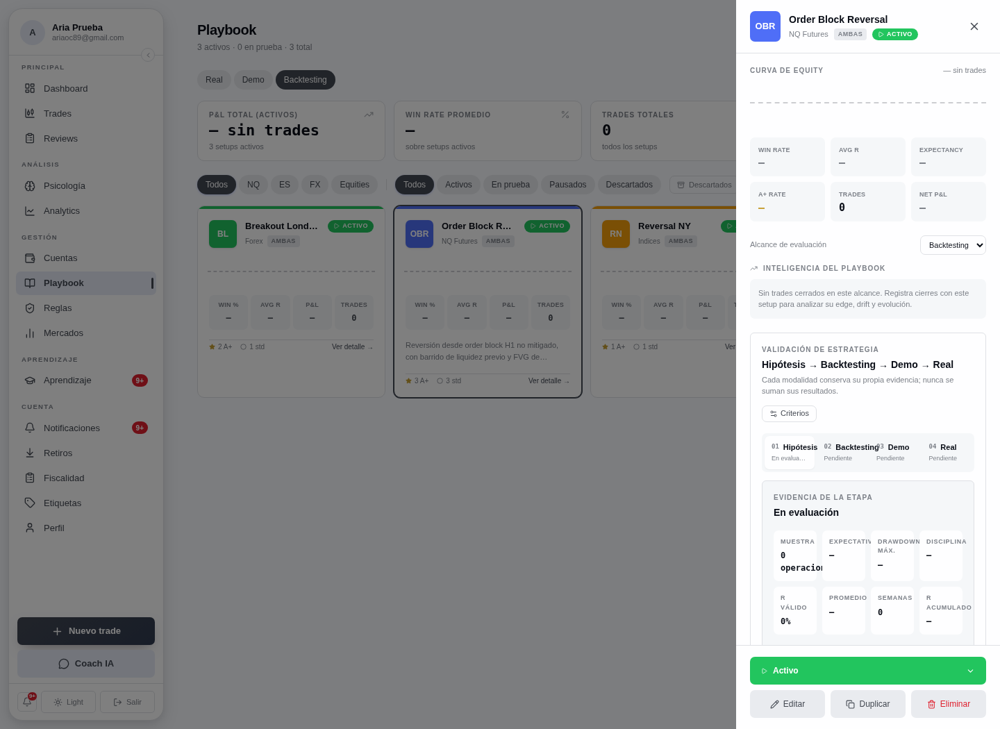
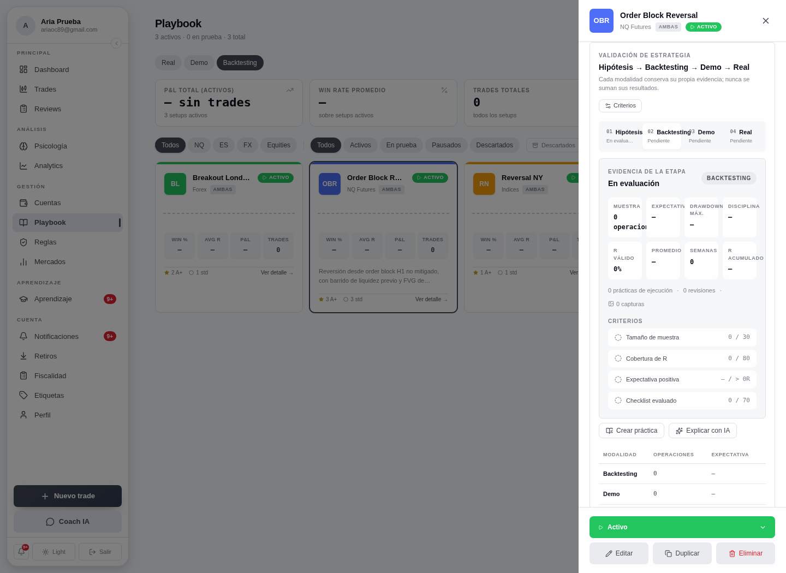
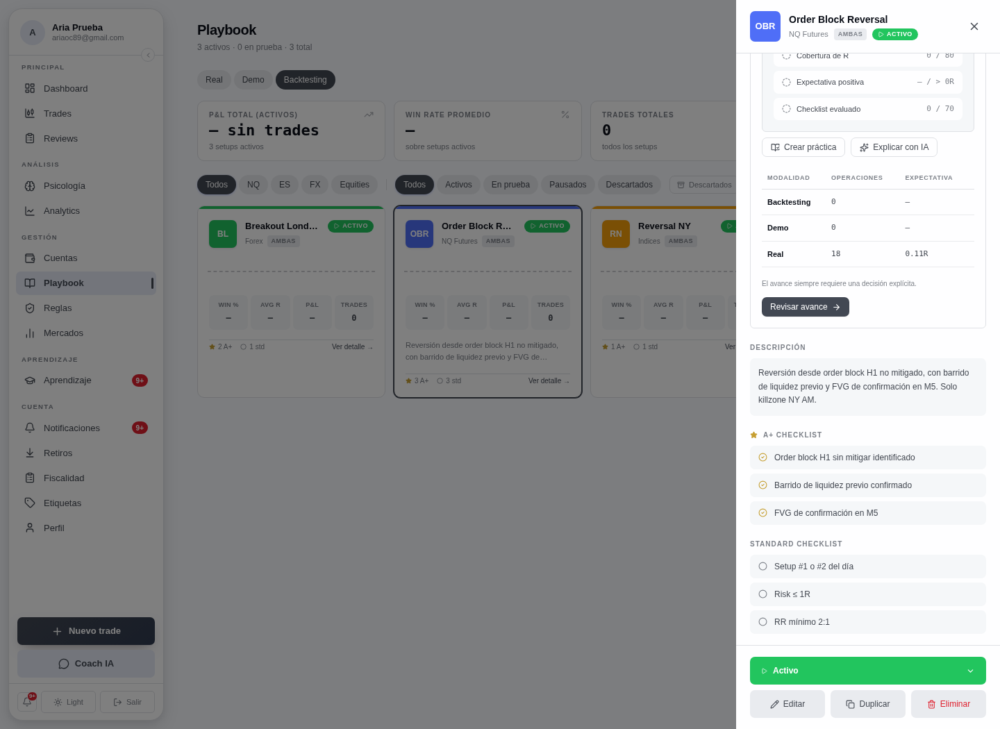
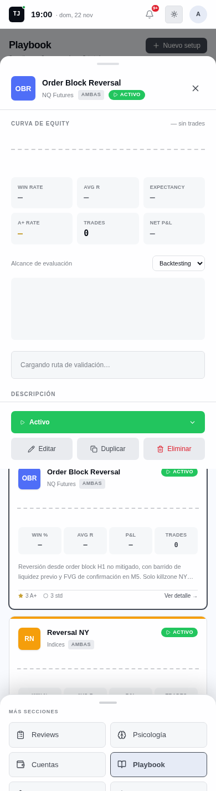

# Manual de uso — Playbook y Setups

> Última actualización: 23 de noviembre de 2026.

El módulo **Playbook** permite definir, probar y mantener las estrategias que utilizas para operar. Cada estrategia se registra como un **setup**: una ficha con mercado, dirección, descripción, imágenes, checklists y parámetros de edge esperado.

El Playbook no ejecuta operaciones ni garantiza que una estrategia sea rentable. Su función es convertir una idea operativa en una definición medible, relacionarla con tus trades y ayudarte a detectar si la ejecución conserva o pierde su edge.

## 1. Conceptos esenciales

| Concepto | Significado |
|---|---|
| Playbook | Biblioteca completa de tus estrategias y sus resultados |
| Setup | Definición de una estrategia o patrón de entrada concreto |
| Checklist Standard | Condiciones mínimas para considerar que el trade respetó el plan |
| Checklist A+ | Condiciones óptimas que distinguen una ejecución de máxima calidad |
| Edge esperado | Hipótesis cuantitativa: win rate, R promedio y rango de R previstos |
| Inteligencia del playbook | Comparación entre la definición y los resultados observados |
| Ruta de validación | Proceso Hipótesis → Backtesting → Demo → Real |

## 2. Abrir el módulo

1. Inicia sesión en TjournalX.
2. En el menú lateral, entra en **Playbook**.
3. Selecciona **Real**, **Demo** o **Backtesting** según el ámbito que quieras analizar.

La definición del setup —nombre, descripción, dirección y checklists— es común para las tres modalidades. Sus métricas, curvas, errores e inteligencia se calculan únicamente con los trades de la modalidad seleccionada.

> Cambiar de modalidad no mueve ni duplica trades. Solo cambia el alcance de los datos mostrados.

## 3. Leer la vista general

### Indicadores superiores

| Indicador | Qué representa |
|---|---|
| P&L Total (activos) | Resultado de los setups con estado Activo en la modalidad elegida |
| Win Rate promedio | Promedio de win rate de los setups activos con evidencia |
| Trades totales | Cantidad de trades vinculados a setups dentro de esa modalidad |
| En prueba | Cantidad y abreviaturas de los setups que aún están en evaluación |

`—` o **sin trades** significa que todavía no existe evidencia suficiente en ese alcance. No equivale a un resultado de cero.

### Filtros

Puedes filtrar por:

- mercado: Todos, NQ, ES, FX o Equities;
- estado: Activos, En prueba, Pausados o Descartados;
- botón **Descartados**, que incluye u oculta los setups archivados.

Los descartados están ocultos inicialmente. El contador de la derecha indica cuántos setups cumplen los filtros actuales.

### Errores recurrentes → lecciones

Cuando existen errores repetidos en los trades de la modalidad seleccionada, TjournalX los ordena por coste en R. **Convertir en regla** abre el Coach IA con ese error y su impacto para ayudarte a plantear una regla o compromiso.

Esta acción no crea ni activa una regla automáticamente: debes revisar y confirmar cualquier propuesta.

## 4. Crear un setup

Pulsa **Nuevo setup**. El formulario está dividido en **Información**, **Checklists** y **Edge**.

### 4.1 Información

Completa:

- **Nombre del setup:** nombre descriptivo y fácil de reconocer.
- **Abreviatura:** hasta cuatro caracteres; aparecerá en tarjetas y selectores.
- **Mercado:** NQ Futures, ES Futures, GC Futures, FX, Equities, Crypto u Otro.
- **Dirección:** Long, Short o Ambas.
- **Estado inicial:** Activo, En prueba o Pausado.
- **Color:** identificación visual del setup.
- **Descripción:** contexto, condiciones, invalidaciones y forma de ejecución.
- **Imágenes de referencia:** ejemplos correctos, estructuras o anotaciones del patrón.

El nombre y la abreviatura son obligatorios. Una buena descripción debe permitir que otra persona entienda cuándo el patrón existe y cuándo no.

### 4.2 Checklists

Separa las condiciones en dos niveles:

- **Standard:** requisitos mínimos para afirmar que el trade siguió el plan.
- **A+:** requisitos adicionales que representan la mejor versión del setup.

Al registrar un trade:

- si completa todo el checklist Standard, TjournalX lo clasifica como **Plan**;
- si completa Standard y todos los criterios A+, lo clasifica como **A+**;
- si falta algún criterio Standard, no recibe automáticamente esas clasificaciones.

Usa criterios observables. Por ejemplo, “barrido de liquidez confirmado” es más útil que “se veía bien”.

### 4.3 Edge esperado

Los campos son opcionales:

- **Win Rate esperado (%):** entre 0 y 100.
- **Avg R esperado:** R promedio que esperas obtener por trade.
- **Mínimo R aceptable:** límite inferior de la expectativa operativa.
- **Máximo R objetivo:** límite superior previsto.

El máximo no puede ser menor que el mínimo. Estos valores no modifican los trades: sirven como referencia para comparar teoría y ejecución, detectar drift y advertir una posible degradación.

### 4.4 Guardado y recuperación de borradores

- Pulsa **Crear setup** para guardar.
- Si intentas cerrar con cambios, TjournalX pide confirmación antes de descartarlos.
- Si la ventana o la página se interrumpe, el formulario puede ofrecer **Recuperar borrador** la próxima vez que lo abras.
- El borrador es local y no cuenta como setup creado hasta guardar.

## 5. Estados de un setup

| Estado | Uso recomendado | Disponibilidad al registrar un trade actual |
|---|---|---|
| Activo | Estrategia aprobada para tu operativa actual | Disponible |
| En prueba | Estrategia en Backtesting o validación controlada | Disponible |
| Pausado | Estrategia detenida temporalmente para revisión | No disponible |
| Descartado | Estrategia retirada del flujo habitual | No disponible y oculta inicialmente |

Los registros históricos pueden conservar la relación con un setup pausado o descartado para no perder trazabilidad. Cambiar el estado no borra sus trades ni altera sus resultados.

## 6. Interpretar las tarjetas

Cada tarjeta resume:

- nombre, abreviatura, mercado, dirección y estado;
- curva de equity de la modalidad actual;
- win rate, Avg R, P&L y cantidad de trades;
- número de criterios A+ y Standard;
- versión de la definición, cuando existe historial;
- indicador de salud.

### Indicador de salud

| Indicador | Lectura |
|---|---|
| ⚪ | Muestra insuficiente; normalmente menos de cinco trades |
| 🟢 | Comportamiento saludable dentro de la evidencia disponible |
| 🟡 | Rendimiento que requiere atención |
| 🔴 | Deterioro crítico que conviene revisar antes de seguir operando |

El color es una señal de revisión, no una orden automática para activar o suspender la estrategia.

## 7. Abrir el detalle del setup

Pulsa una tarjeta para abrir su panel. En escritorio aparece a la derecha; en móvil, como una hoja desde la parte inferior.

El panel contiene:

1. curva de equity y P&L;
2. win rate, Avg R, expectativa, A+ Rate, trades y P&L neto;
3. inteligencia del playbook;
4. ruta de validación;
5. descripción y checklists;
6. historial de versiones;
7. imágenes de referencia;
8. estado y acciones de mantenimiento.

### Inteligencia del playbook

El selector **Alcance de evaluación** permite revisar Real, Demo o Backtesting. El análisis muestra:

- cierres y operaciones con R válido;
- cobertura y cumplimiento del checklist;
- edge estable, mejorando, deteriorándose o con muestra insuficiente;
- diferencia entre el setup definido y el realmente ejecutado;
- evolución del Avg R por ventanas;
- comparación antes/después de una redefinición, cuando hay evidencia.

Una muestra insuficiente significa que TjournalX todavía no puede sostener una conclusión. No debe interpretarse como edge estable ni como fallo.

## 8. Validar Hipótesis → Backtesting → Demo → Real

La ruta conserva la evidencia de cada mundo por separado:

| Etapa | Propósito |
|---|---|
| Hipótesis | Definir mercado, dirección, descripción, expectativa y checklist |
| Backtesting | Comprobar la idea con datos históricos |
| Demo | Verificar la ejecución sin capital real |
| Real | Monitorear continuidad, deterioro y desviaciones con capital real |

**Criterios** permite configurar los mínimos de cada etapa. **Revisar avance** registra una decisión explícita; TjournalX nunca promueve una estrategia automáticamente. Si existe una brecha, **Crear práctica** genera un borrador en Aprendizaje.

Para criterios, excepciones, decisiones, IA y monitoreo Real, consulta el [manual completo de la ruta de validación](MANUAL_RUTA_VALIDACION_ESTRATEGIAS.md).

## 9. Editar y consultar versiones

Pulsa **Editar** para abrir nuevamente Información, Checklists y Edge.

Cuando cambia la **dirección** o cualquiera de los **checklists**, TjournalX conserva una versión anterior. En **Historial de versiones** podrás ver:

- fecha y número de versión;
- elementos añadidos;
- elementos eliminados;
- cambio de dirección.

Los criterios de la ruta de validación tienen su propio versionado independiente. Editar una descripción o un valor de edge no debe confundirse con una decisión de promoción de etapa.

## 10. Cambiar estado, duplicar o eliminar

### Cambiar estado

Abre el selector de estado y elige Activo, En prueba, Pausado o Descartado. El cambio afecta su disponibilidad futura, no los trades ya registrados.

### Duplicar

**Duplicar** crea una copia con:

- el mismo mercado, dirección, descripción, imágenes, checklists y edge;
- el sufijo **(copia)** en el nombre;
- estado inicial **En prueba**.

La copia comienza sin heredar los trades del setup original.

### Eliminar

**Eliminar** pide escribir el nombre exacto del setup. Es una acción irreversible para la definición, pero los trades asociados no se eliminan.

Antes de eliminar, considera **Pausar** o **Descartar** si quieres conservar la definición y su historial para futuras revisiones.

## 11. Usar el setup al registrar un trade

1. Abre **Nuevo trade**.
2. Selecciona una cuenta; su tipo determina si el trade pertenece a Real, Demo o Backtesting.
3. Selecciona el setup.
4. Marca los criterios Standard y A+ que realmente se cumplieron.
5. Completa el trade y guárdalo.

La relación con el setup alimenta las métricas, la curva, la disciplina, la inteligencia y la ruta de validación. No selecciones un setup solo para mejorar una estadística: debe corresponder al patrón realmente ejecutado.

## 12. Uso en móvil

- El panel ocupa la mayor parte de la pantalla y puede desplazarse verticalmente.
- Las acciones permanecen en la zona inferior.
- Las mismas métricas, checklists y etapas están disponibles que en escritorio.
- Cierra el panel con **X** o tocando fuera de él.

## 13. Flujo recomendado

1. Crea el setup como **En prueba**.
2. Define la hipótesis, Standard, A+ y edge antes de observar los resultados.
3. Registra Backtesting con fechas y datos históricos correctos.
4. Corrige brechas mediante prácticas de Aprendizaje.
5. Promueve a Demo mediante una decisión documentada.
6. Comprueba que la disciplina se mantenga antes de pasar a Real.
7. En Real, revisa periódicamente drift, evolución y errores recurrentes.
8. Pausa o devuelve la estrategia a revisión si la evidencia se deteriora.

## 14. Problemas frecuentes

### Las métricas cambiaron al pulsar Real, Demo o Backtesting

Es el comportamiento esperado: la definición es compartida, pero cada modalidad tiene resultados independientes.

### Veo `—` en las métricas

No hay trades suficientes, no están cerrados o falta R válido. Revisa también que los trades estén vinculados al setup y a la modalidad correcta.

### No encuentro un setup al registrar un trade

Los setups Pausados o Descartados no se ofrecen para una operación actual. Cámbialo a Activo o En prueba únicamente si realmente volverás a utilizarlo.

### No aparecen errores recurrentes

Ese panel solo se muestra cuando existen etiquetas de error repetidas y con impacto medible en la modalidad elegida.

### La inteligencia dice “Muestra insuficiente”

Continúa recopilando cierres con R y checklists evaluados. No rebajes criterios únicamente para obtener un veredicto.

### Cerré el formulario sin guardar

Vuelve a abrirlo. Si el navegador conservó el borrador, TjournalX ofrecerá recuperarlo o descartarlo.

## 15. Buenas prácticas

- Define criterios antes de mirar el resultado de la muestra.
- Evita setups demasiado amplios que agrupen patrones diferentes.
- Usa nombres y abreviaturas inequívocos.
- Mantén Standard corto, obligatorio y observable.
- Reserva A+ para condiciones realmente selectivas.
- Registra el checklist con honestidad, incluso en trades perdedores.
- No mezcles Backtesting, Demo y Real para justificar una conclusión.
- Documenta los cambios de definición y el motivo de cada excepción.
- Prefiere Pausar o Descartar antes de Eliminar cuando exista valor histórico.

## 16. Límites del módulo

El Playbook analiza los datos registrados en TjournalX. No valida la calidad de fuentes externas, no ejecuta órdenes, no predice rendimientos futuros y no sustituye tu gestión de riesgo. Un setup elegible o saludable indica que cumple criterios medidos; no constituye una garantía de rentabilidad.
