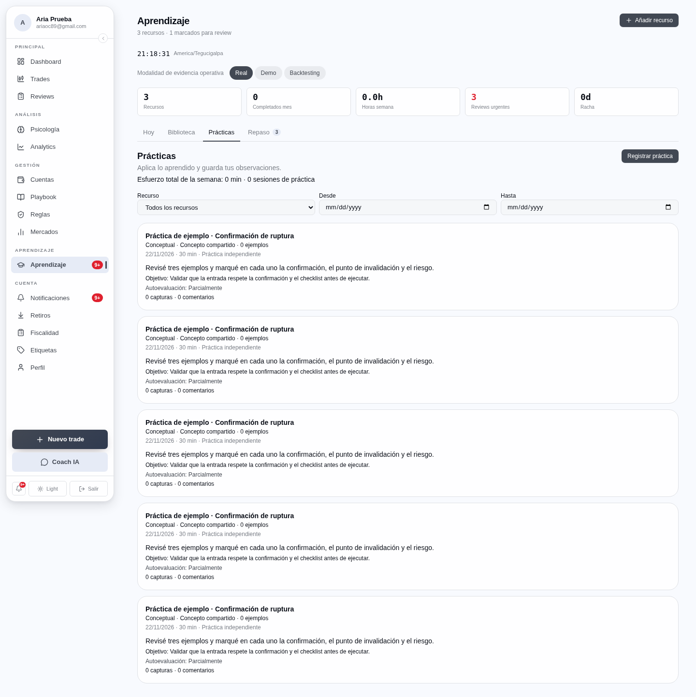
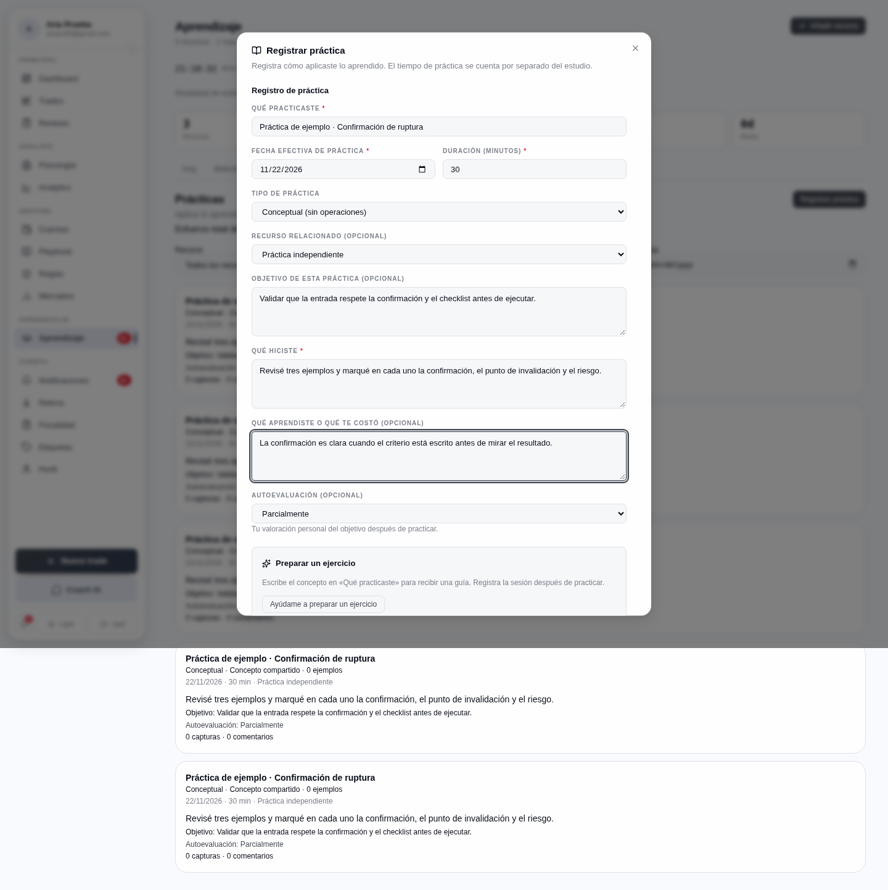
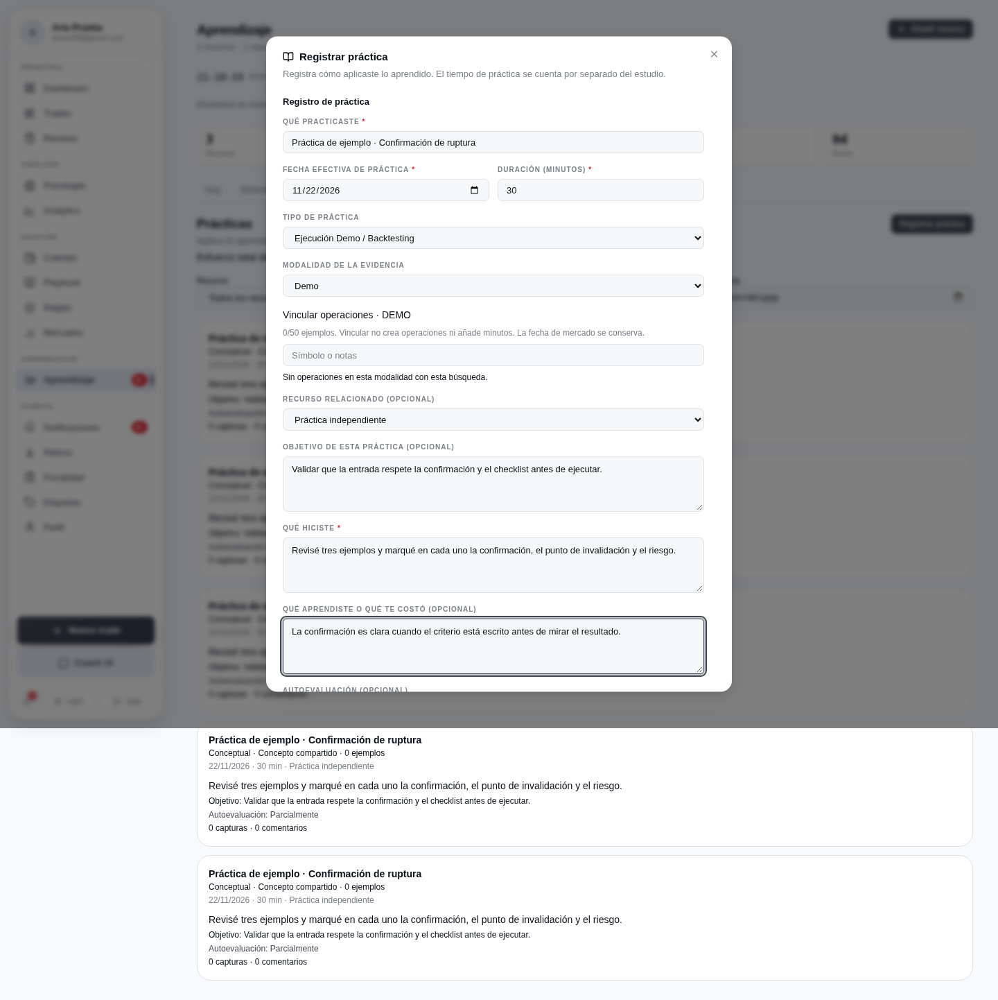
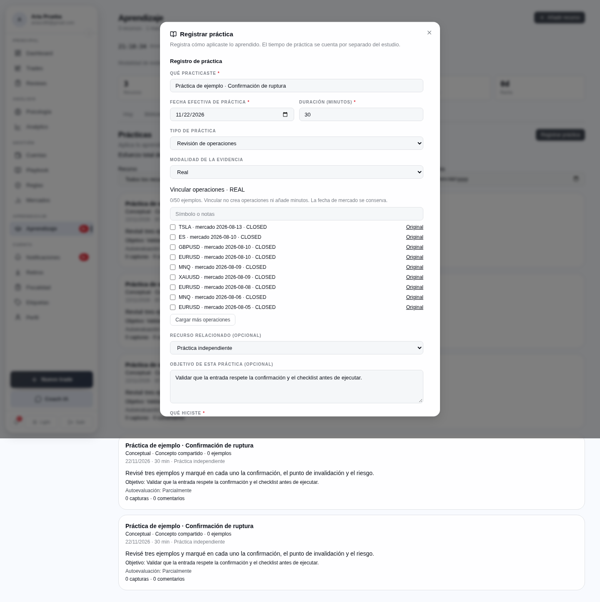
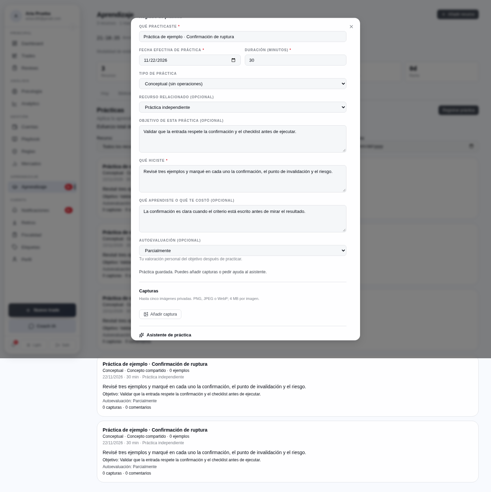
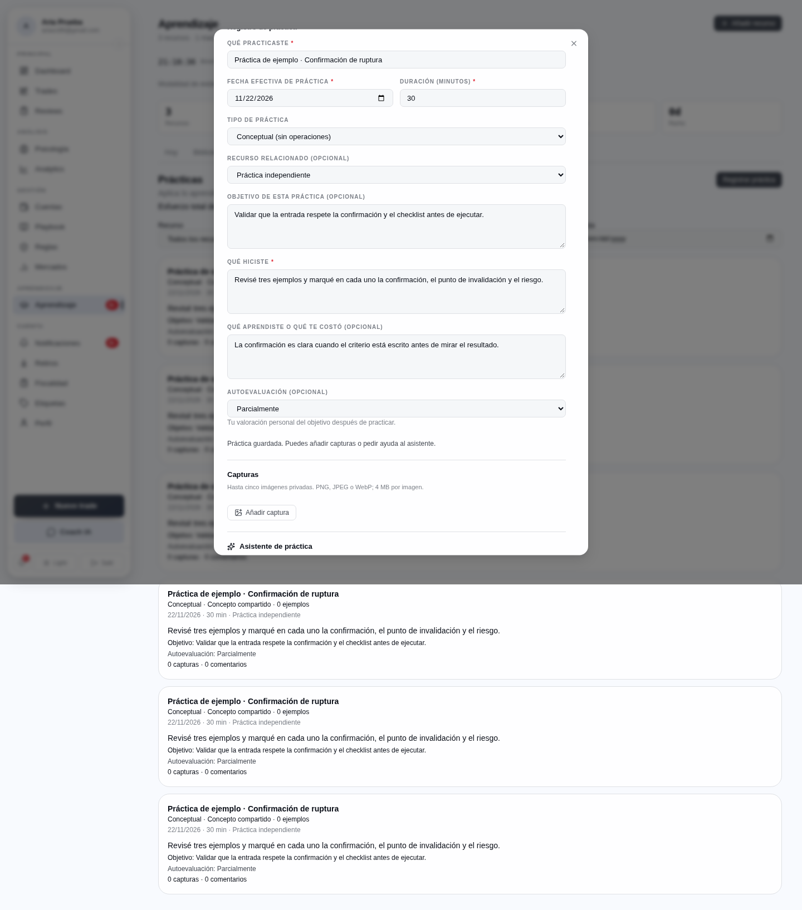
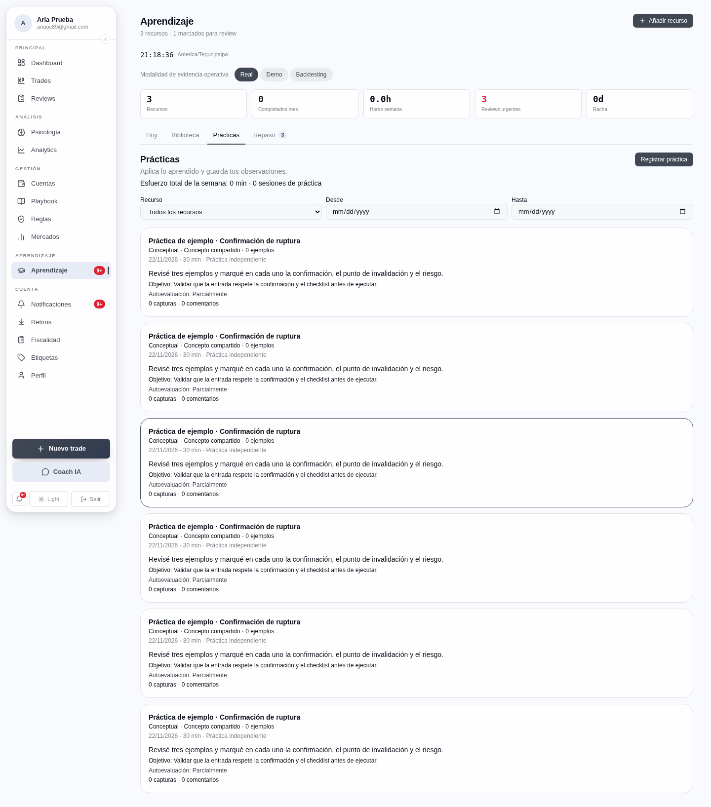
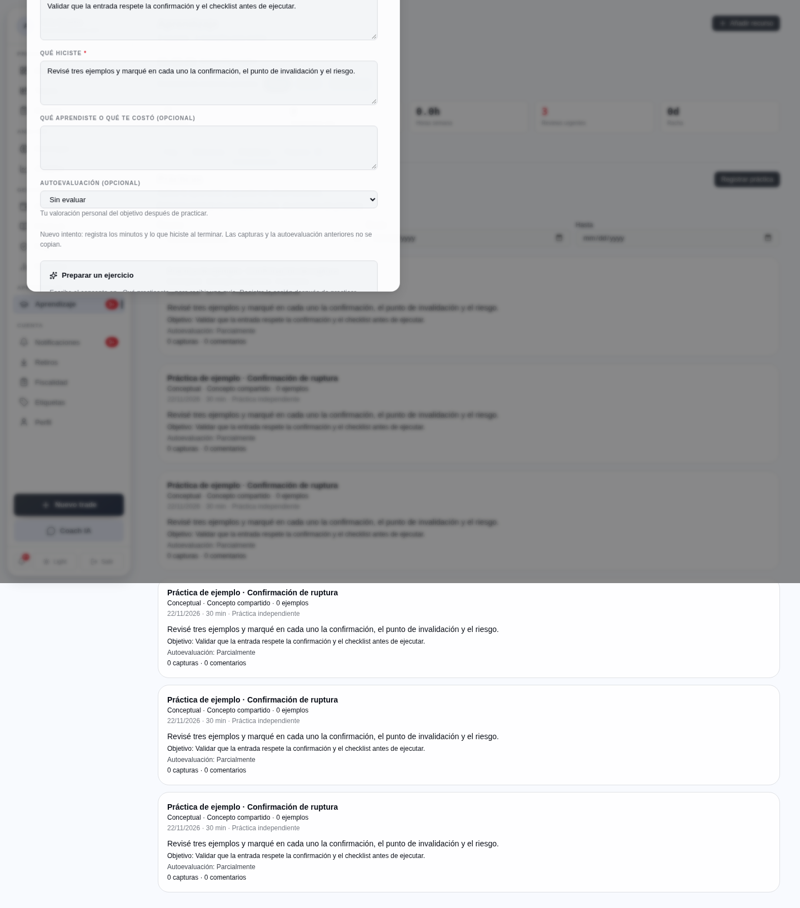
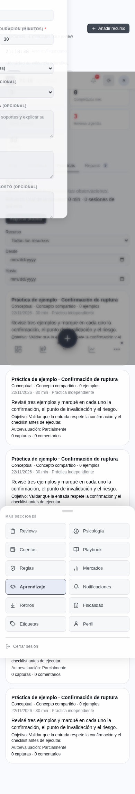

# Manual de uso — Prácticas de Aprendizaje

> Última actualización: 23 de noviembre de 2026.

El apartado **Prácticas** convierte lo aprendido en ejercicios verificables. Permite registrar qué practicaste, cuánto tiempo dedicaste, qué evidencia operativa revisaste, qué conclusión obtuviste y qué debes repetir.

Una práctica puede ser conceptual, de ejecución o de revisión. Puede hacerse de forma independiente, a partir de un recurso de la biblioteca, desde una sesión planificada o como respuesta a una brecha detectada en la ruta de validación de un setup.

Prácticas no ejecuta operaciones, no crea trades y no modifica P&L, capital ni estadísticas. Cuando vinculas trades, estos funcionan únicamente como evidencia de aprendizaje.

## 1. Conceptos esenciales

| Concepto | Significado |
|---|---|
| Sesión de estudio | Tiempo dedicado a consumir o estudiar un recurso |
| Práctica | Aplicación deliberada de un concepto o estrategia |
| Práctica conceptual | Ejercicio sin operaciones vinculadas |
| Ejecución | Práctica con trades de Demo o Backtesting que realmente ejecutaste |
| Revisión | Análisis posterior de trades de Real, Demo o Backtesting |
| Evidencia operativa | Trades vinculados a la práctica sin alterar sus datos originales |
| Captura | Imagen privada que documenta el análisis o resultado |
| Intento | Cada realización de un ejercicio; repetir crea un registro nuevo |
| Autoevaluación | Tu valoración: logrado, parcial, repetir o sin evaluar |

> El tiempo de práctica se contabiliza por separado del tiempo de estudio. Así puedes distinguir cuánto consumes de cuánto aplicas.

## 2. Abrir el apartado

1. Inicia sesión en TjournalX.
2. En el menú lateral, entra en **Aprendizaje**.
3. Abre la pestaña **Prácticas**.
4. Si trabajarás con evidencia operativa, selecciona **Real**, **Demo** o **Backtesting** en la cabecera.



La vista muestra:

- minutos y sesiones de práctica de la semana;
- filtros por recurso y rango de fechas;
- historial de intentos;
- botón **Registrar práctica**;
- tipo, modalidad, fecha, duración, recurso, objetivo, autoevaluación, capturas, comentarios y cantidad de trades vinculados de cada registro.

La semana se calcula con la zona horaria configurada en tu perfil. Cambiar la modalidad superior no transforma ni mueve datos: delimita el mundo operativo desde el que estás trabajando.

## 3. Elegir el tipo correcto

| Tipo | Para qué sirve | Modalidades permitidas | Vínculo con trades |
|---|---|---|---|
| Conceptual | Practicar definiciones, reglas, lectura de contexto, identificación de patrones o construcción de checklists | Concepto compartido | No admite trades |
| Ejecución | Ejecutar una estrategia en un entorno sin capital real | Demo o Backtesting | Trades ejecutados durante la práctica |
| Revisión | Estudiar decisiones o resultados ya registrados | Real, Demo o Backtesting | Trades revisados como casos |

### Ejemplos

- **Conceptual:** identificar diez confirmaciones válidas y diez invalidaciones en gráficos históricos.
- **Ejecución Demo:** aplicar el checklist del setup durante una sesión demo y vincular los trades realizados.
- **Ejecución Backtesting:** reproducir casos históricos, registrar las entradas y vincularlas al ejercicio.
- **Revisión Real:** analizar tres trades reales, localizar desviaciones del plan y definir una corrección.

No utilices **Ejecución** para afirmar que ejecutaste trades reales. La ejecución deliberada dentro de Prácticas está limitada a Demo y Backtesting; los trades reales pueden estudiarse mediante **Revisión**.

## 4. Registrar una práctica conceptual

Pulsa **Registrar práctica** y completa el formulario.



### Campos

| Campo | Requisito | Uso recomendado |
|---|---|---|
| Qué practicaste | Obligatorio, hasta 160 caracteres | Un nombre concreto y reconocible |
| Fecha efectiva | Obligatoria, no futura | El día en que realmente hiciste el ejercicio |
| Duración | Obligatoria, entre 1 y 1,440 minutos | Solo tiempo efectivo de práctica |
| Tipo de práctica | Obligatorio | Conceptual, Ejecución o Revisión |
| Recurso relacionado | Opcional | Lección, video, libro o material que aplicaste |
| Objetivo | Opcional, hasta 1,000 caracteres | Resultado observable que buscabas conseguir |
| Qué hiciste | Obligatorio, hasta 5,000 caracteres | Procedimiento, muestra y reglas aplicadas |
| Qué aprendiste o qué te costó | Opcional, hasta 5,000 caracteres | Hallazgo, dificultad y siguiente ajuste |
| Autoevaluación | Opcional | Logrado, parcialmente, repetir o sin evaluar |

Un buen registro responde cuatro preguntas:

1. ¿Qué habilidad concreta entrené?
2. ¿Qué procedimiento seguí?
3. ¿Qué evidencia observé?
4. ¿Qué cambiaré en el siguiente intento?

Evita descripciones como “practiqué trading”. Prefiere algo verificable: “clasifiqué 20 rupturas según cierre, volumen e invalidación sin mirar el resultado posterior”.

### Borradores y cierre accidental

Mientras el registro no se haya guardado, TjournalX puede conservar un borrador local recuperable. Si intentas cerrar con cambios, solicita confirmación antes de descartarlos. El borrador no cuenta como práctica ni suma minutos.

## 5. Registrar ejecución en Demo o Backtesting

Selecciona **Ejecución** y elige la modalidad de la evidencia.



Puedes vincular operaciones compatibles con la modalidad elegida. Considera estas reglas:

- una práctica admite hasta 50 trades únicos;
- todos los trades vinculados deben pertenecer a la misma modalidad;
- un trade solo puede ser evidencia de ejecución de una práctica;
- vincularlo no cambia su fecha de mercado, cuenta, resultado, setup ni estadísticas;
- la fecha efectiva de la práctica y la fecha histórica del trade pueden ser distintas;
- el vínculo documenta que ese trade formó parte del ejercicio.

Si ejecutas una sesión de Backtesting con datos históricos, registra los trades con su fecha real de mercado y la práctica con la fecha en que realizaste el ejercicio. Así TjournalX conserva ambas verdades: **cuándo ocurrió el escenario** y **cuándo lo practicaste**.

## 6. Registrar una revisión de operaciones

Selecciona **Revisión** para analizar trades ya existentes. Real, Demo y Backtesting están permitidos.



Una misma operación puede aparecer en distintas prácticas de revisión cuando responden preguntas diferentes. Por ejemplo:

- una revisión del cumplimiento del checklist;
- otra sobre gestión emocional;
- otra sobre salida y relación riesgo/beneficio.

No mezcles modalidades dentro del mismo intento. Si deseas comparar Real y Demo, crea una práctica para cada mundo y contrasta después sus conclusiones.

## 7. Usar el asistente antes de guardar

Con un título escrito, pulsa **Ayúdame a preparar un ejercicio**. El Coach IA puede proponer una estructura de práctica, pasos y criterios de observación.

La propuesta es una ayuda editable: revísala, adáptala a tu setup y decide si deseas usarla como guía. No sustituye tu criterio ni confirma por sí sola que una ejecución sea correcta.

Para usar esta función necesitas una configuración de IA válida en **Perfil → Configuración de IA**. Los límites de uso protegen el servicio; si haces varias solicitudes seguidas, puede pedirte esperar antes de continuar.

## 8. Guardar y completar el registro

Pulsa **Guardar práctica**. Una vez guardada, el modal cambia a **Tu práctica** y habilita las funciones posteriores.



El registro ya cuenta en el resumen semanal. Puedes seguir editando sus notas, objetivo y autoevaluación. Guarda los cambios antes de añadir capturas o solicitar un comentario nuevo, para que la evidencia y la IA trabajen sobre la versión correcta.

Si el registro cambió desde otro navegador o pestaña, TjournalX puede advertir un conflicto de versión. Revisa el contenido más reciente antes de volver a guardar para no sobrescribir cambios sin intención.

## 9. Adjuntar capturas y pedir retroalimentación

Después de guardar aparecen **Capturas** y **Asistente de práctica**.



### Capturas

- máximo de 5 imágenes por práctica;
- formatos PNG, JPEG o WebP;
- hasta 4 MB por imagen desde la interfaz;
- almacenamiento privado asociado a tu usuario;
- opción de ampliar o eliminar cada imagen.

Utiliza capturas legibles, sin credenciales ni información personal innecesaria. Una evidencia útil muestra contexto, entrada, invalidación, objetivo y las anotaciones que sustentan tu conclusión.

### Asistente de práctica

Pulsa **Ayúdame a practicar** o **Comentar esta práctica** para pedir retroalimentación. El asistente puede considerar:

- objetivo, ejercicio, reflexión y autoevaluación;
- modalidad y trades vinculados;
- reglas y procedencia de la práctica;
- capturas, cuando solicitas que sean analizadas;
- configuración del Coach IA de tu perfil.

Cada comentario queda guardado. Si luego modificas el ejercicio, TjournalX distingue el comentario de la **versión actual** de los comentarios hechos sobre versiones anteriores.

La IA puede señalar inconsistencias o proponer preguntas, pero no certifica rentabilidad, cumplimiento normativo ni validez absoluta del análisis. Contrasta siempre sus observaciones con tus reglas y datos.

## 10. Consultar el historial

Cierra el modal para regresar al listado.



Usa los filtros para localizar:

- prácticas relacionadas con un recurso concreto;
- intentos dentro de un periodo;
- registros del ámbito operativo seleccionado;
- ejercicios que necesitan repetirse.

Cuando existen más resultados, pulsa **Cargar más prácticas**. La tarjeta conserva suficiente contexto para comparar intentos sin confundir minutos de estudio, evidencia operativa ni resultados financieros.

## 11. Volver a practicar

Abre una práctica guardada y pulsa **Volver a practicar**.



TjournalX crea un intento nuevo y copia:

- título;
- ejercicio;
- objetivo;
- recurso relacionado;
- tipo y modalidad;
- procedencia de revisión, cuando corresponda.

No copia la duración, reflexión, autoevaluación, capturas ni comentarios del intento anterior. Debes registrar evidencia nueva. Esto evita que una repetición aparente progreso sin haber sido realizada.

Usa esta función cuando la autoevaluación indique **Necesito repetir**, cuando la IA detecte un punto débil o cuando quieras comprobar si la corrección ya se volvió consistente.

## 12. Prácticas desde una sesión planificada

Si abres Prácticas desde una sesión planificada:

- el recurso de la planificación queda fijado;
- al guardar, la sesión planificada se marca como completada;
- la duración se contabiliza como práctica;
- no se añaden minutos de estudio ficticios.

Esto permite planificar “aplicar la lección” sin confundirla con volver a consumir el recurso.

## 13. Prácticas desde la ruta de validación

Una brecha de un setup puede generar un borrador de práctica con contexto de estrategia, etapa y criterio pendiente. Revisa la propuesta y guárdala únicamente después de realizar el ejercicio.

El vínculo conserva la procedencia para que puedas responder:

- qué brecha motivó la práctica;
- en qué etapa ocurrió: Hipótesis, Backtesting, Demo o Real;
- qué intentos hiciste para resolverla;
- qué evidencia operativa respaldó cada intento.

Crear el borrador no cambia el veredicto del setup. La ruta de validación se actualiza con sus propias evidencias y criterios.

## 14. Editar o eliminar

Abre una tarjeta para editarla. Si necesitas borrar el registro, pulsa **Eliminar práctica** y confirma.

La eliminación retira la práctica, sus capturas y comentarios. No elimina los trades vinculados ni modifica sus resultados. Si la práctica completó una sesión planificada, dicha sesión vuelve a quedar pendiente.

Antes de eliminar, considera conservar los intentos que documentan una evolución real. Un ejercicio fallido también es evidencia útil si explica qué cambiaste después.

## 15. Uso en móvil

El formulario se adapta a pantallas pequeñas y mantiene las mismas reglas.



En móvil puedes registrar notas y evidencias inmediatamente después de la sesión. Para revisar listas largas de trades o comparar varias capturas, una pantalla mayor suele ser más cómoda.

## 16. Flujo recomendado

1. Define una habilidad observable, no un objetivo genérico.
2. Elige Conceptual, Ejecución o Revisión según lo que realmente harás.
3. Separa Real, Demo y Backtesting.
4. Escribe el criterio de éxito antes de mirar el resultado.
5. Realiza el ejercicio y registra solo el tiempo efectivo.
6. Vincula trades o capturas que respalden la conclusión.
7. Autoevalúa con honestidad.
8. Pide retroalimentación al asistente si aporta una segunda lectura.
9. Convierte la dificultad principal en el objetivo del siguiente intento.
10. Repite y compara, sin reemplazar el historial anterior.

### Plantilla breve

```text
Objetivo: identificar y ejecutar únicamente rupturas con cierre confirmado.
Ejercicio: revisar 20 casos sin ver el resultado posterior y clasificar válido/inválido.
Evidencia: tabla de clasificación, capturas y trades Demo o Backtesting.
Criterio de éxito: al menos 18 clasificaciones coherentes con el checklist.
Reflexión: error más frecuente, causa y ajuste para el siguiente intento.
```

## 17. Preguntas frecuentes

### ¿Una práctica vinculada altera mis estadísticas?

No. El vínculo es evidencia de aprendizaje. No cambia P&L, capital, fecha, setup ni métricas del trade.

### ¿Puedo vincular un trade histórico?

Sí. El trade conserva su fecha de mercado y la práctica conserva la fecha en que hiciste el ejercicio.

### ¿Puedo mezclar Real, Demo y Backtesting?

No dentro del mismo intento. Crea registros separados para mantener resultados y conclusiones comparables.

### ¿Por qué Ejecución no permite Real?

Porque el apartado de práctica deliberada protege la separación de mundos. La operativa real se puede analizar mediante Revisión.

### ¿Puedo revisar el mismo trade varias veces?

Sí, en prácticas de Revisión. Un trade solo puede representar la ejecución de una práctica, pero puede estudiarse desde varios ángulos.

### ¿Las capturas son obligatorias?

No. Son recomendables cuando ayudan a verificar el razonamiento o permiten que el asistente examine el contexto visual.

### ¿El Coach IA decide si aprobé?

No. Ofrece retroalimentación. Tu autoevaluación, tus reglas y la evidencia determinan el siguiente paso.

### ¿Repetir sobrescribe el intento anterior?

No. **Volver a practicar** crea un intento independiente y conserva el historial.

### ¿La duración suma a mi tiempo de estudio?

No. Los minutos de práctica se muestran y contabilizan por separado.

## 18. Límites y seguridad

- TjournalX es una herramienta de registro, aprendizaje y análisis; no ejecuta operaciones.
- Una práctica o comentario de IA no garantiza rendimiento futuro.
- Mantén Real, Demo y Backtesting separados para evitar conclusiones engañosas.
- No subas secretos, claves, credenciales ni documentos personales como capturas.
- Revisa la modalidad, fecha y trades antes de guardar: la trazabilidad depende de esos datos.
- Conserva evidencia suficiente para poder explicar cómo llegaste a cada conclusión.

El objetivo del módulo no es acumular minutos. Es producir una cadena verificable: **concepto → ejercicio → evidencia → reflexión → corrección → nuevo intento**.
