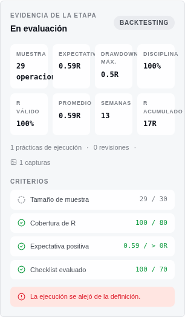
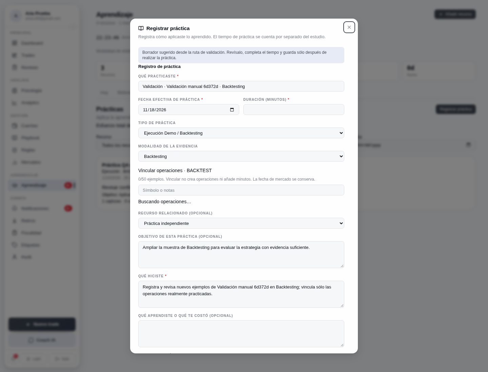
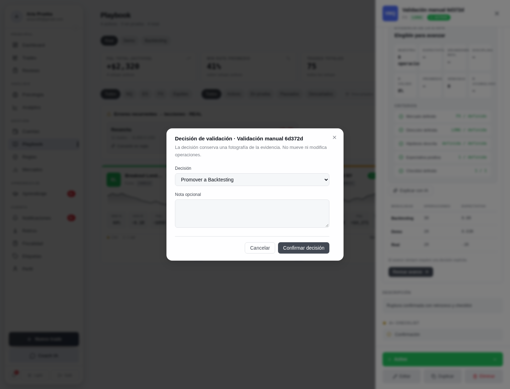
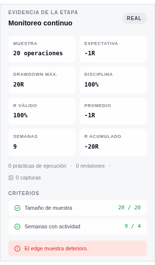

# Manual de uso — Ruta de validación de estrategias

> Última actualización: 18 de noviembre de 2026.

La ruta de validación ayuda a comprobar una estrategia por etapas sin mezclar los resultados de Backtesting, Demo y Real. Es una herramienta de decisión y seguimiento: no ejecuta operaciones, no altera el P&L y no certifica por sí sola que una estrategia sea rentable.

## 1. Abrir la ruta

1. Entra en **Playbook**.
2. Abre el setup que quieres evaluar.
3. Busca la sección **Validación de estrategia**.
4. Usa las pestañas **Hipótesis**, **Backtesting**, **Demo** y **Real** para revisar la evidencia de cada etapa.

Cada modalidad conserva sus operaciones y estadísticas por separado. La tabla comparativa permite contrastarlas, pero TjournalX nunca presenta un P&L total combinado.

## 2. Qué significa cada etapa

| Etapa | Qué valida | Evidencia principal |
|---|---|---|
| Hipótesis | Que la idea esté definida antes de probarla | Mercado, dirección, descripción, expectativa y checklist |
| Backtesting | Que exista una muestra histórica suficiente y trazable | Operaciones cerradas, cobertura de R, checklist y expectativa |
| Demo | Que la ejecución se sostenga sin capital real | Muestra, semanas activas, disciplina y expectativa |
| Real | Que el edge se mantenga con capital real | Muestra reciente, continuidad temporal, deterioro y desviación de la definición |

`—` significa que todavía no hay evidencia suficiente para calcular una métrica. No equivale a cero.

## 3. Leer la evidencia

La tarjeta de cada etapa muestra:

- muestra de operaciones cerradas;
- expectativa y promedio en R;
- drawdown máximo y R acumulado;
- cobertura de R y disciplina de checklist;
- semanas con actividad;
- prácticas de ejecución, revisiones y capturas vinculadas.

Debajo aparecen los criterios individuales. Un criterio pendiente explica exactamente qué falta. El estado **Elegible para avanzar** significa que se alcanzaron los umbrales configurados; el avance sigue requiriendo una decisión manual.

## 4. Ajustar los criterios

Pulsa **Criterios** para adaptar los mínimos de Backtesting, Demo y monitoreo Real. Los valores iniciales son una guía prudente, no una norma universal.

Al guardar, TjournalX crea una versión nueva de la política. Las decisiones anteriores conservan la versión y la fotografía de evidencia con las que fueron tomadas; no se reescribe la historia.

Conviene cambiar criterios sólo cuando exista una justificación metodológica y antes de evaluar los resultados, para evitar ajustar la regla a posteriori.

## 5. Convertir una brecha en práctica

Si hay un criterio pendiente, pulsa **Crear práctica**. TjournalX abre Aprendizaje con un borrador basado en el setup, la etapa y la brecha seleccionada.

El borrador no registra minutos, trades ni progreso automáticamente. Revisa el ejercicio, completa los campos y guarda la práctica sólo después de realizarla. Las prácticas y capturas vinculadas aparecerán después como contexto de aprendizaje en la ruta.

## 6. Registrar una decisión

Pulsa **Revisar avance** y elige una acción:

- **Promover**: avanza a la etapa siguiente.
- **Continuar en revisión**: mantiene la etapa actual y registra la revisión.
- **Suspender estrategia**: detiene la validación sin borrar evidencia.
- **Reanudar estrategia**: reactiva una estrategia suspendida.
- **Volver a la etapa anterior**: abre de nuevo la etapa previa para revisión.

Si promueves con criterios pendientes, debes escribir un motivo de excepción. La decisión queda en un historial inmutable con su etapa, política y evidencia. TjournalX no promueve estrategias automáticamente.

## 7. Usar la explicación con IA

**Explicar con IA** resume la evidencia visible y propone próximos pasos. La IA recibe sólo contexto acotado de la estrategia, métricas de la etapa y un máximo de diez prácticas relacionadas.

La respuesta es orientativa y temporal: no se guarda como decisión, no modifica criterios, no mueve la estrategia y no sustituye tu juicio. Verifica cualquier recomendación contra los datos y tu plan de trading.

## 8. Monitoreo continuo en Real

Real no es una etapa “terminada”. TjournalX continúa comparando la ejecución con la definición y muestra advertencias cuando detecta deterioro del edge o alejamiento del plan.

Una advertencia no baja la estrategia automáticamente. Puedes mantenerla en revisión, suspenderla o volver a una etapa anterior mediante una decisión explícita.

## 9. Notificaciones

TjournalX crea una notificación cuando una etapa actual queda elegible para avanzar o cuando aparece una advertencia de validación. Las notificaciones se deduplican por estrategia, etapa y estado; nuevas operaciones que mantienen el mismo estado no generan copias.

## 10. Buenas prácticas

- Registra los trades en la cuenta y modalidad correctas.
- Usa datos históricos sólo en Backtesting y ejecución simulada en Demo.
- Completa R y checklist para evitar métricas incompletas.
- No rebajes los criterios únicamente para habilitar una promoción.
- Documenta toda excepción y conserva capturas de las prácticas importantes.
- Trata Real como monitoreo continuo, no como una certificación definitiva.

## 11. Límites de la función

La ruta no predice resultados futuros, no valida la calidad de datos externos, no presenta una suma financiera entre modalidades y no sustituye un proceso independiente de gestión de riesgo. La elegibilidad confirma que se cumplieron criterios configurados; no garantiza rentabilidad.
