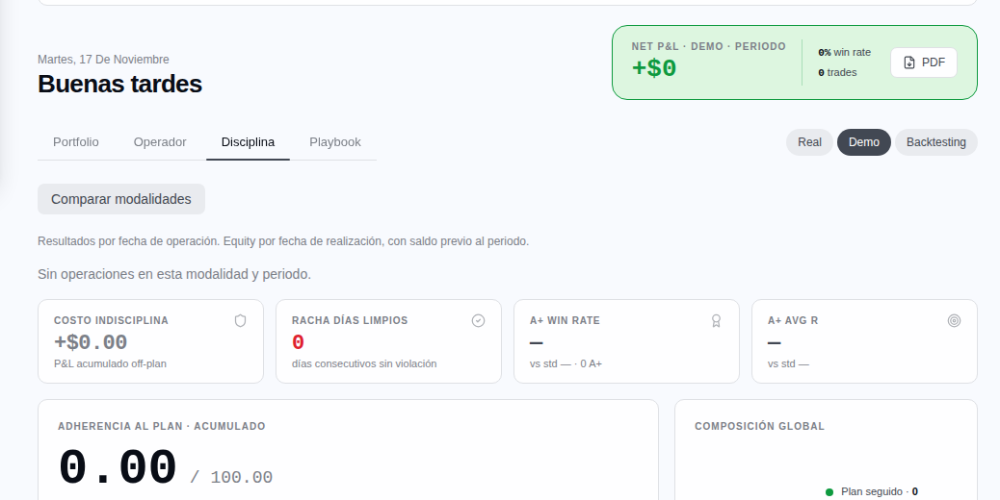
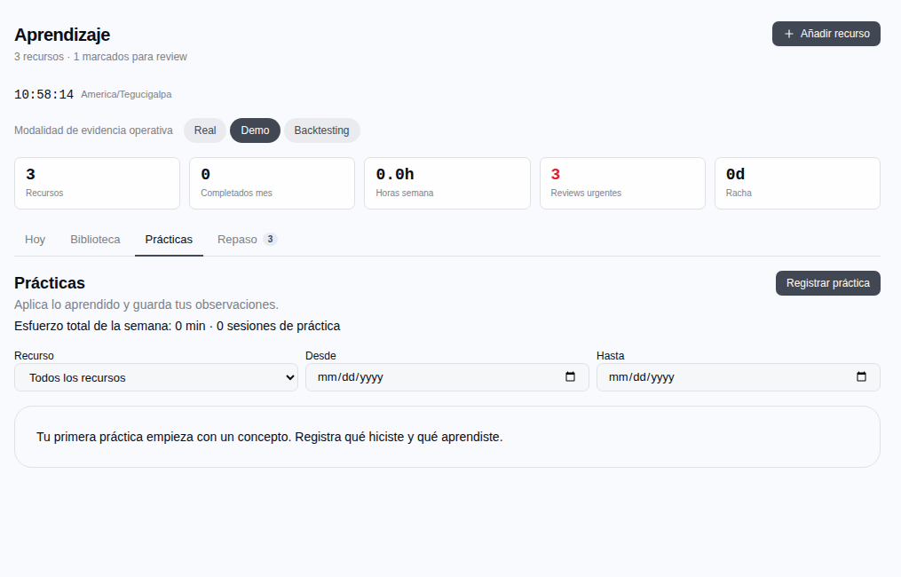
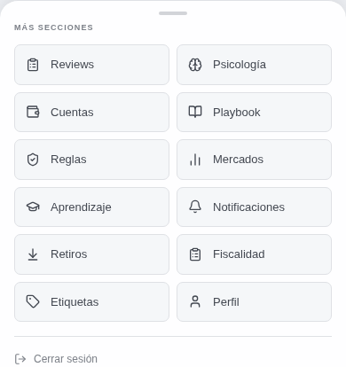

# Real, Demo, Backtesting y Prácticas

Este anexo muestra cómo orientar la navegación y reconocer la modalidad activa. [Leer el manual de mundos operativos](../MANUAL_MUNDOS_OPERATIVOS.md)

## Dashboard en Demo

Con **Demo** activo, el resumen indica **NET P&L · DEMO · PERIODO**. En el ejemplo aparecen cero trades. Los recursos y repasos del plan del día se mantienen visibles porque el contenido educativo es compartido.

## Evidencia operativa en Prácticas

En **Aprendizaje → Prácticas**, elige Real, Demo o Backtesting en **Modalidad de evidencia operativa**. Al pulsar **Registrar práctica**, puedes indicar la fecha efectiva, la duración, el tipo de ejercicio y su objetivo. Si agregas operaciones, selecciona las que correspondan a la modalidad del ejercicio.

Una operación histórica conserva su fecha de mercado. Si practicas hoy con esa operación, registra la fecha de hoy para contabilizar tu esfuerzo de aprendizaje.

## Navegación móvil

Pulsa el botón de tres puntos de la barra inferior para abrir **Más secciones** y entrar a **Aprendizaje**, **Playbook** u otro módulo. El botón central de la barra permite registrar un trade.

## Secuencia de uso

1. Selecciona la modalidad y usa una cuenta de ese mismo tipo.
2. Para una operación terminada, elige **Histórico cerrado** y registra apertura, cierre, zona horaria y resultado neto.
3. Si la operación forma parte de un ejercicio, registra también la práctica con la fecha efectiva y los minutos dedicados.
4. Usa **Ejecución** para practicar en Demo o Backtesting y **Revisión** para analizar operaciones existentes.
5. Lee Dashboard, Analytics, Playbook y Reviews en la modalidad que seleccionaste.
